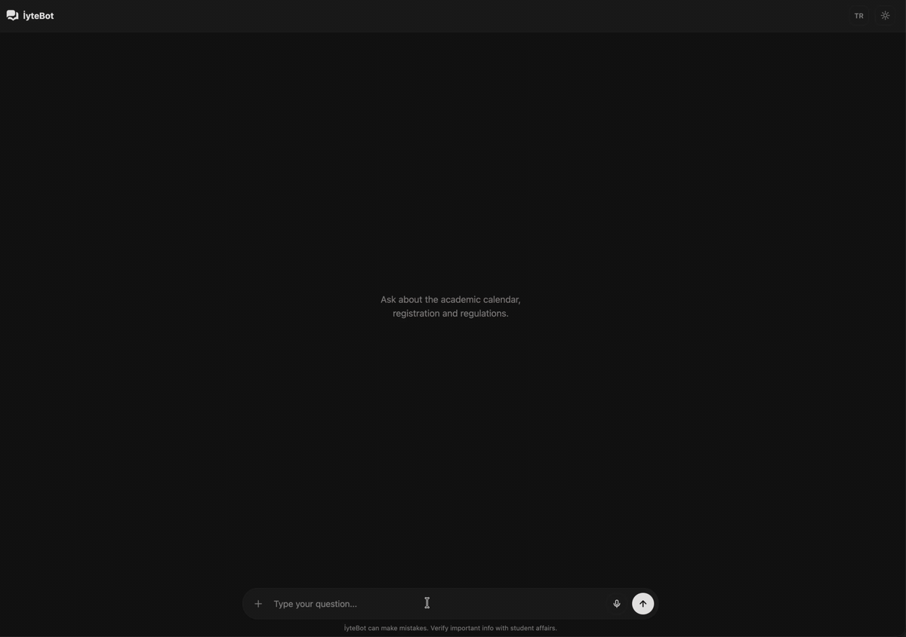
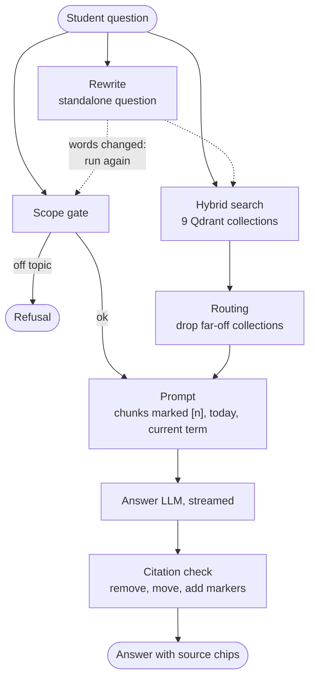
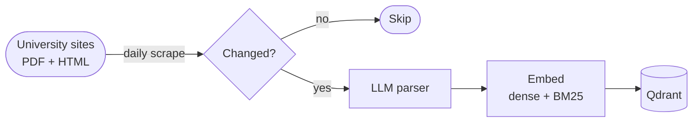

# İyteBot

[](https://github.com/raccoon-42/student-affairs-chatbot/actions/workflows/tests.yml)

[](LICENSE)

A Turkish chatbot for İYTE students. It answers from the university's own
documents — academic calendar, regulations, FAQs, forms, campus services,
programs, people, courses and student guides — and cites a source for every
fact.

FastAPI, Qdrant and a vanilla JS web UI. Models run through OpenRouter:
Claude Haiku 5.5 writes the answers, Sonnet 5.5 parses documents and judges
the eval.



## Answering a question



- The gate and the search start on the student's own words while the
  rewrite runs; they run again only if the rewrite changes the words.
- Search is dense + BM25 in every collection. A collection whose best match
  is 0.20 below the top one is left out.
- Every chunk carries a `[n]` marker. After the answer, a rule-based check
  drops markers the chunk doesn't back, moves misplaced ones and adds
  missing ones.

## Keeping the data fresh



The `check-updates` service runs this every day at 06:30 UTC. Only changed
sources are parsed and embedded again.

## Run

```bash
cp .env.example .env        # add OPENROUTER_API_KEY
docker compose up --build   # http://localhost:8000
```

On a fresh clone, `check-updates` indexes everything on first start:
`docker compose logs -f check-updates`. Production setup: `deploy/README.md`.

## Develop

```bash
uv sync
uv run pytest                                            # offline tests
uv run uvicorn app.api.api:app --reload                  # http://localhost:8000
uv run python -m preprocessing.check_updates --dry-run   # what changed upstream
```

The LLM judge grades answers against `tests/test_cases/*.json`. It needs
the stack running and costs money:

```bash
uv run pytest -m integration tests/test_llm_judge.py -v
```

## More

- `CONTEXT.md`: domain vocabulary
- `.env.example`, `config/settings.py`: configuration
- `CONTRIBUTING.md`: how changes get in

## License

CC BY-NC 4.0, non-commercial use only. See `LICENSE`.
